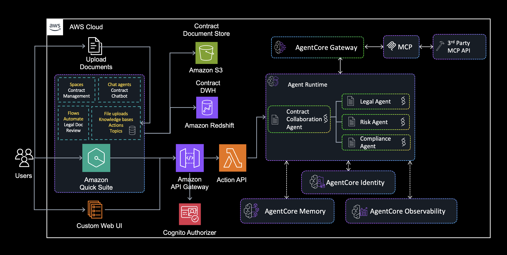

# Intelligent Contract Management with Amazon Quick Suite and AgentCore

A multi-agent legal contract analyzer built on Amazon Bedrock AgentCore, surfaced to end
users through Amazon Quick Suite. Four specialized agents extract clauses, assess risk, check
regulatory compliance, and synthesize an executive report with an approve/review/reject
recommendation.

## Architecture



```
Quick Suite  ──►  API Gateway  ──►  Lambda  ──┬──►  Legal Clause Agent    ─┐
              (Cognito OAuth)    (orchestrator)├──►  Legal Risk Agent      ─┤ in parallel
                                               └──►  Compliance Agent      ─┘
                                                          │
                                                          ▼
                                              Response Agent (synthesis)
```

The Lambda fans out to the three analysis agents concurrently, then passes their combined
output to the response agent. Running the analysis agents in parallel rather than
sequentially is what keeps the request inside API Gateway's 29-second ceiling.

| Agent | Role | Output |
|---|---|---|
| `legal_clause_agent` | Extracts and categorizes key clauses | Up to 10 clauses with type, summary, importance, key terms |
| `legal_risk_agent` | Assesses legal, financial, operational risk | Up to 5 risks with severity, impact, mitigation, plus a 0-100 score |
| `compliance_agent` | Checks regulatory and policy compliance | Five compliance areas with status, gaps, severity, plus a 0-100 score |
| `response_agent` | Synthesizes the other three into a report | Markdown executive report and a decision recommendation |

## Repository layout

```
legal-contract-solution/
├── agentcore/                     # AgentCore CLI project
│   ├── agentcore.json             # Agent (runtime) definitions
│   ├── aws-targets.json           # Deployment target: account + region
│   ├── cdk/                       # Generated CDK infrastructure
│   └── .cli/                      # Generated at deploy time, not committed
├── app/                           # Agent source — one directory per agent
│   ├── legal_clause_agent/        #   main.py, pyproject.toml, Dockerfile
│   ├── legal_risk_agent/
│   ├── compliance_agent/
│   └── response_agent/
├── deployment/
│   ├── quicksuite_lambda.py       # Orchestrating Lambda handler
│   ├── deploy_quicksuite_integration.py  # Lambda + Cognito + API Gateway + schema
│   └── cleanup.py                 # Teardown
├── ui/quick-suite/
│   └── api_gateway_openapi_schema.json   # Schema template for Quick Suite import
├── sample_contract.txt            # Test contract with known, documented defects
├── sample_questions.txt           # Questions to ask about it
├── SAMPLE_CONTRACT.md             # What is wrong with the contract and why
└── requirements.txt               # Local tooling only (boto3)
```

Agent runtime dependencies live in each `app/<agent>/pyproject.toml`, not in
`requirements.txt`.

## Prerequisites

- AWS account with Amazon Bedrock model access
- **Node.js 20+** — the AgentCore CLI is distributed via npm
- **Python 3.12+** and the AWS CLI, configured with credentials
- No local Docker required; container images are built remotely by AWS CodeBuild

Install the CLI:

```bash
npm install -g @aws/agentcore
```

> If you previously used `bedrock-agentcore-starter-toolkit`, uninstall it. It is deprecated
> and provides a conflicting `agentcore` command:
> `pip uninstall bedrock-agentcore-starter-toolkit`

### Model access

Agents default to `us.anthropic.claude-haiku-4-5-20251001-v1:0`. Note this is an **inference
profile ID**, not a bare model ID. Current Claude models do not support on-demand invocation
by raw model ID and will fail with:

```
Invocation of model ID ... with on-demand throughput isn't supported.
Retry your request with the ID or ARN of an inference profile.
```

List what your account can use:

```bash
aws bedrock list-inference-profiles --region us-east-1 \
  --query 'inferenceProfileSummaries[?contains(inferenceProfileName, `Claude`)].[inferenceProfileId,status]' \
  --output table
```

Claude 3.x models are marked `LEGACY` and are blocked for accounts that have not invoked them
recently, so prefer an `ACTIVE` profile. To change models, edit the `BEDROCK_MODEL_ID`
environment variable in `agentcore/agentcore.json` and redeploy.

## Deploy

### 1. Set your deployment target

`agentcore/aws-targets.json` ships with a placeholder account. Replace it with yours:

```bash
cd legal-contract-solution
sed -i '' "s/123456789012/$(aws sts get-caller-identity --query Account --output text)/" \
  agentcore/aws-targets.json
```

Adjust `region` in the same file if you are not deploying to `us-east-1`.

### 2. Deploy the agents

```bash
agentcore validate      # check agentcore/ config
agentcore deploy        # build images in CodeBuild, deploy via CDK
```

This creates one AgentCore runtime per agent plus a CloudFormation stack named
`AgentCore-LegalContractAnalyzer-default`. First deploy takes several minutes because
CodeBuild builds four ARM64 images. Confirm afterwards:

```bash
agentcore status
```

### 3. Deploy the Quick Suite integration

```bash
python -m venv .venv && source .venv/bin/activate
pip install -r requirements.txt
python deployment/deploy_quicksuite_integration.py
```

This reads the agent ARNs from `agentcore/.cli/deployed-state.json` and creates the Lambda,
a Cognito user pool with a client-credentials app client, an API Gateway REST API with a
Cognito authorizer, and a ready-to-import OpenAPI schema. It writes two gitignored files:

- `quicksuite_integration_config.json` — includes the **client secret**, do not commit
- `quicksuite_openapi_schema.json` — import this into Quick Suite

### 4. Connect Quick Suite

1. Quick Suite console → **Connectors** → **Create for your team** → **OpenAPI Specification**
2. Import `quicksuite_openapi_schema.json`
3. Choose **Service authentication** (client credentials) and supply the client ID, client
   secret, and token URL from `quicksuite_integration_config.json`

## Try it

`sample_contract.txt` is a 19,000-character services agreement seeded with 15 documented
defects — an indemnity carved out of the liability cap, a "commercially reasonable" breach
notice instead of GDPR's 72 hours, cross-border PII transfer with no DPA, an evergreen
auto-renewal, and others. `SAMPLE_CONTRACT.md` maps each defect to the clause and the agent
expected to catch it; `sample_questions.txt` has questions to ask.

Invoke the orchestrating Lambda directly:

```bash
python3 -c "import json;c=open('sample_contract.txt').read();q='Is our liability actually capped under this agreement?';open('/tmp/payload.json','w').write(json.dumps({'body':json.dumps({'contract_text':c,'user_question':q})}))"

aws lambda invoke \
  --function-name legal-contract-api \
  --cli-binary-format raw-in-base64-out \
  --payload file:///tmp/payload.json \
  --region us-east-1 \
  /tmp/response.json

python3 -c "import json;d=json.load(open('/tmp/response.json'));b=json.loads(d['body']);print(b['agent_results']);print(b['contract_analysis'].get('summary_response',''))"
```

`agent_results` reports per-agent status and is the fastest way to confirm all four agents
ran rather than the request degrading to a partial answer.

## Performance and timeout constraints

Measured warm, with the 19,000-character sample contract:

| Stage | Elapsed |
|---|---|
| Clause, risk, compliance (parallel) | 7-11s |
| Response agent synthesis | +9-11s |
| **Total** | **19-22s** |

This matters because of two hard limits that cannot be raised:

| Path | Timeout | Notes |
|---|---|---|
| API Gateway REST API | **29s** | The integration timeout ceiling |
| Quick Suite MCP connector | **60s** | Fixed; no streaming or partial updates |

That leaves roughly 7-10 seconds of headroom on the API Gateway path. Two practical
consequences:

- **Warm up before demoing.** A cold container start will distort the first request and can
  exceed the budget. Send one throwaway invocation first.
- **Agent output is deliberately capped** to hold the budget. Latency here is bound by token
  generation, not input size — doubling the contract length added only ~4s. Caps are
  overridable per agent via `agentcore.json` `envVars` (redeploy required):

| Variable | Default |
|---|---|
| `CLAUSE_AGENT_MAX_TOKENS` / `CLAUSE_AGENT_MAX_CLAUSES` | 1800 / 10 |
| `RISK_AGENT_MAX_TOKENS` / `RISK_AGENT_MAX_RISKS` | 1500 / 5 |
| `COMPLIANCE_AGENT_MAX_TOKENS` | 1500 |
| `RESPONSE_AGENT_MAX_TOKENS` | 2000 |

Raising them improves depth at the cost of latency.

## Teardown

```bash
python deployment/cleanup.py          # prompts for confirmation
python deployment/cleanup.py --yes    # non-interactive
python deployment/cleanup.py --keep-agents   # Quick Suite layer only
```

Removes the API Gateway, Lambda, Cognito pool, IAM role, and the CloudFormation stack holding
the agent runtimes. Deliberately left in place because they may be shared: the CDK bootstrap
stack (`CDKToolkit`) and its staging bucket, ECR images, and CloudWatch log groups.

## Troubleshooting

**`This runtime is not MMDSv2-enabled and can no longer be invoked`**
As of June 30, 2026 AgentCore requires MMDSv2 on all runtimes. Runtimes created before then
have `requireMMDSV2: false`. Redeploying with `agentcore deploy` produces compliant runtimes.
To patch an existing runtime in place:

```bash
aws bedrock-agentcore-control update-agent-runtime \
  --agent-runtime-id <id> --metadata-configuration requireMMDSV2=true \
  --agent-runtime-artifact <current> --role-arn <current> \
  --network-configuration <current> --region us-east-1
```

**`Invocation of model ID ... with on-demand throughput isn't supported`**
Use an inference profile ID (`us.` or `global.` prefix). See [Model access](#model-access).

**`Access denied. This Model is marked by provider as Legacy`**
The configured model is `LEGACY` and unused for 30+ days. Switch to an `ACTIVE` profile.

**504 Gateway Timeout from Quick Suite**
The analysis exceeded API Gateway's 29s limit, usually a cold start. Warm the agents, or
lower the `*_MAX_TOKENS` caps.

**Agent returns a generic template instead of analyzing the contract**
The response agent received no `contract_text` and no upstream analyses. Check that the
Lambda's `ALL_AGENT_ARNS` environment variable is populated and that `agent_results` does not
show `skipped`.

**Agent status is `error` but the runtime is healthy**
Usually the agent's JSON parse step failing on a Markdown-fenced response. Each agent strips
``` fences before parsing; check CloudWatch logs for the raw response.

Agent logs:

```bash
agentcore logs --runtime legal_risk_agent --level error
aws logs tail /aws/lambda/legal-contract-api --follow
```

## Security notes

- API Gateway is protected by a Cognito authorizer using the OAuth 2.0 client credentials
  flow with a scoped resource server. There is no unauthenticated path to the agents.
- `quicksuite_integration_config.json` contains the Cognito **client secret** and is
  gitignored. Do not commit it.
- `agentcore/.env.local` is gitignored and should hold any local API keys.
- The Lambda execution role grants `bedrock-agentcore:InvokeAgentRuntime` and
  `GetAgentRuntime` on `Resource: "*"`. Scope this to specific runtime ARNs for production.
- Contract text is sent to Amazon Bedrock for inference and appears in CloudWatch logs at
  INFO level. Review log retention and redaction before using real contracts.

## Further reading

- [AgentCore CLI](https://github.com/aws/agentcore-cli)
- [Amazon Bedrock AgentCore Runtime](https://docs.aws.amazon.com/bedrock-agentcore/latest/devguide/)
- [Quick Suite OpenAPI integration](https://docs.aws.amazon.com/quick/latest/userguide/openapi-integration.html)
- [Quick Suite MCP integration](https://docs.aws.amazon.com/quick/latest/userguide/mcp-integration.html)
- [Strands Agents](https://strandsagents.com/)

## License

MIT — see [LICENSE](../LICENSE). Contributions welcome; see [CONTRIBUTING.md](CONTRIBUTING.md).
